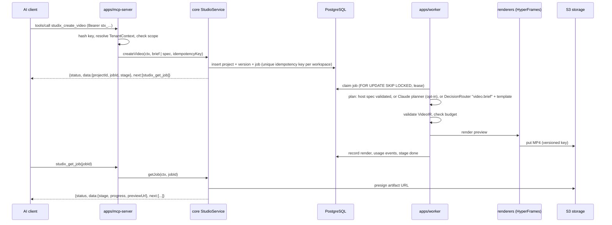
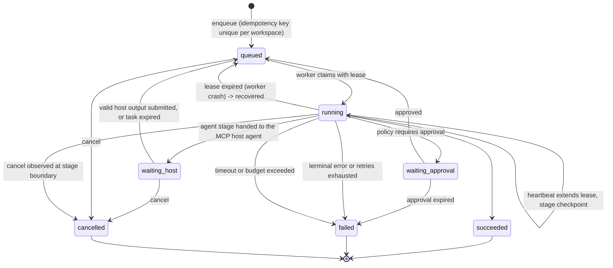

# Architecture

Studix is a modular monolith: one repository, one domain service layer, two
runtime roles (`app`, `worker`) built from one container image, plus an
independent static marketing site. This file records the boundaries and why
they exist. Package source is the authority for behavior.

Status: **P0 target**. Each package row names its owner path; once that path
exists, read it instead of this table.

## System diagram


The marketing site imports no engine code and shares no runtime with the app.

## Package ownership

The rule behind every boundary: each external dependency has exactly one owning
package, so upstream churn changes one wrapper. Packages are scoped `@studix/*`
and export `./src/index.ts`.

| Path                        | Owns                                                                                                                                                                                                                 | Must not                                                            |
| --------------------------- | -------------------------------------------------------------------------------------------------------------------------------------------------------------------------------------------------------------------- | ------------------------------------------------------------------- |
| `apps/mcp-server`           | HTTP app: `/mcp` (native + meta tools), `/api` for the dashboard, dashboard static files, `/healthz`, `/readyz`                                                                                                      | Contain pipeline or policy logic; it calls `core` and `mcp-gateway` |
| `apps/worker`               | Worker process: claims jobs and runs workflow stages                                                                                                                                                                 | Expose public HTTP beyond health                                    |
| `apps/dashboard`            | SPA for projects, storyboard review and approval, jobs, traces, playback, connectors                                                                                                                                 | Implement its own pipeline; it uses `/api` over `StudioService`     |
| `apps/marketing`            | Static marketing site on Cloudflare                                                                                                                                                                                  | Import engine packages                                              |
| `apps/mock-mcp`             | Third-party Streamable HTTP MCP fixture for gateway tests                                                                                                                                                            | Ship to production                                                  |
| `packages/shared`           | `StudixError` + `ErrorCode`, `loadConfig()` (env only, zod), logger with redaction, `newId()`, `redact()`, `Clock`                                                                                                   | Depend on other `@studix/*` packages                                |
| `packages/video-ir`         | `VideoIR`, `Scene`, `Shot`, `Timeline`, `AssetRef`, `BrandKit`, `CreativeBrief`, `RenderSpec`, `Storyboard` schemas, validation, dependency digests, JSON Schema export, `schemaVersion` migrations, golden fixtures | Import any renderer or provider                                     |
| `packages/core`             | Domain entities, `TenantContext`, port interfaces, `ApprovalPolicy`, `StudioService`; also owns assets and review (ADR-0001)                                                                                         | Import adapters; it defines ports only                              |
| `packages/database`         | Drizzle schema, SQL migrations, tenant-scoped repositories, `createDb()`, `withTestDatabase()`                                                                                                                       | Export an unscoped query API                                        |
| `packages/storage`          | `StorageAdapter` over the S3 API, signed URLs                                                                                                                                                                        | Store binaries in Postgres                                          |
| `packages/workflow`         | Postgres job queue, typed stages (input/output schemas, `cacheKey`), stage cache reuse, scheduler, crash recovery, budget checks, approval gate                                                                      | Call a model or provider SDK directly                               |
| `packages/agent-runtime`    | `AgentRuntime` boundary for Pi and the Claude Agent SDK ([ADR 0011](decisions/0011-claude-agent-runtime-and-provider-auth.md)), plus fakes                                                                           | Run outside the worker role                                         |
| `packages/decision-routing` | `DecisionRouter`, `DecisionProviderAdapter`, OpenRouter, TypeSafeAI, Rules and Fake adapters, shared contract suite                                                                                                  | Leak provider payloads to callers                                   |
| `packages/providers`        | `MediaProvider` contract, Multix adapter over the multix CLI, fake provider, job journal and probe-before-batch policy                                                                                               | Claim kinds whose vendor key is not ready                           |
| `packages/renderers`        | `RendererAdapter`: HyperFrames first, FFmpeg finishing                                                                                                                                                               | Be imported by `core` or `video-ir`                                 |
| `packages/qa`               | QA hard gate, evidence and human-review stages; typed wrappers that run the `tools/qa` Python measurement tools in a per-run sandbox ([QA.md](QA.md))                                                                | Let an AI verdict block or approve; pass worker secrets to a tool   |
| `packages/skills`           | Pack registry: versioned workflow templates and stage templates per genre pack (brand-intro first); knowledge packs loaded per stage, with `hard`/`evidence` check contracts and pack lint                           | Hold tenant data                                                    |
| `packages/mcp-gateway`      | Server registry, tool catalog, policy, URL policy, MCP client adapter, execution, invocation trace                                                                                                                   | Forward the inbound client credential downstream                    |
| `packages/auth`             | Workspace API keys (hash, verify, revoke, scope), dashboard sessions to membership to workspace                                                                                                                      | Store plaintext keys                                                |
| `packages/billing`          | Usage ledger (COGS and price recorded separately), dedupe keys                                                                                                                                                       | Hardcode a credit conversion                                        |
| `packages/observability`    | Trace/span model with org/workspace/project/job/stage/provider/model attributes, redacted                                                                                                                            | Record secrets or raw prompts by default                            |

Search is deferred to P1 (ADR-0001). Infrastructure files (Dockerfile, compose,
Cloudflare and TOSE config) are listed in [DEPLOYMENT.md](DEPLOYMENT.md).

## Request flow: `studix_create_video`



Why this shape:

- The create call returns quickly; no HTTP request waits on a render.
- A host that already wrote a creative spec submits it and the internal planner
  is skipped, so the creative model is never paid for twice.
- The worker is the only role that touches Chromium, FFmpeg, models or media
  providers. The app role stays small and I/O bound.
- The planner is chosen per job. Without a selection the worker uses the default
  planner. A job that selected `planner: {runtime: "claude"}` is planned by the
  Claude Agent SDK subprocess in the worker (`apps/worker/src/planner/claude-planner.ts`)
  with the job's own Anthropic key, a cost cap no larger than the remaining job
  budget, no tools, and output accepted only through `validateVideoIR`. Each run
  writes a provider execution row and a `provider.decision` usage line; there is
  no fallback to the default planner
  ([ADR-0011](decisions/0011-claude-agent-runtime-and-provider-auth.md)).
- Without a per-job planner, a stage can run on a model the workspace or the
  member chose in **AI & Providers**, through the Pi runtime and a workspace key
  enabled for Pi (`apps/worker/src/planner/workspace-model-decisions.ts`). The
  choice is pinned per job at the first attempt; without a choice the operator
  routing runs as before
  ([ADR-0016](decisions/0016-provider-connections-runtimes-and-model-preferences.md)).

## Durable job lifecycle

The queue is a Postgres `jobs` table ([ADR-0005](decisions/0005-durable-jobs-on-postgres.md)).
State names below are conceptual; the enum lives with the job schema in
`packages/core` and `packages/database`.



Invariants:

- A stage checkpoint is written before its side effect is considered done, so a
  recovered job resumes at the last completed stage instead of restarting.
- Usage events carry dedupe keys, so a retried stage never double-bills.
- Per-workspace concurrency is enforced at claim time.
- Approval state lives in Postgres, so it survives worker restarts. Publish and
  high-cost steps fail closed without a recorded approval.
- Mutating downstream MCP calls are not auto-retried when the outcome is unknown.
- A stage with a `cacheKey` whose output is cached for the tenant is checkpointed
  from the cache through the fenced `writeStage` and is not run, gated, budget
  checked or charged again. Outputs enter the cache only after their fenced
  checkpoint ([ADR-0014](decisions/0014-storyboard-revisions-and-stage-cache.md)).
- Parking in `waiting_approval` or `waiting_host` does not consume the attempt,
  so the resumed claim runs at the same attempt number.

## Agent stages

A creative agent stage (`createAgentStage` in `packages/workflow`) has one
contract in both modes: input schema, output schema and limits (turns, tokens,
cost, time and a tool allowlist). `payload.agentMode` picks the mode
([ADR-0015](decisions/0015-agent-stage-caps-and-host-handoff.md)).

- **Harness** (default): the worker's `AgentRuntime` (Claude Agent SDK) runs the
  stage. Every limit is a hard cap. The runtime aborts the session when a cap is
  crossed and settles only after the agent process has stopped; one that does not
  stop within the grace period is killed by handle and reported `INTERNAL`.
- **Host**: the stage opens an `agent_handoffs` task for this attempt and the job
  parks in `waiting_host`. The MCP client's agent fetches the task and submits an
  output. In one transaction, the submission is accepted only while the task is
  pending and unexpired, names the task's attempt, and its job is parked by that
  attempt; the job is then requeued. The worker sweep expires unanswered tasks and
  requeues their jobs.

A cap stop never fails silently. The stage records what the agent spent, writes
its stage row as `pending` and parks the job for an `agent.overrun` approval
(scope `agent:<stage>`). Each approval a person grants allows one more run with
every limit doubled (2^n after n approvals); a rejection fails the stage with
`FORBIDDEN`. Agent spend is the ledger kind `agent.run` (tokens as quantity,
mode, runtime, round and cap in metadata), separate from media cost per stage
and attempt (`splitJobUsage` in `packages/billing`).

## Revisions and invalidation

Every scene and shot of a stored project version gets an immutable revision in
`ir_node_revisions`, keyed by a Merkle digest of the node and everything it
depends on (format, brand, assets, its shots). A patch therefore mints revisions
only for the nodes it invalidated; the rest of the new version points at the
revisions it shares with its parent. `asset_lineage` records which revision or
asset version produced each generated asset version, so the assets made stale by
an edit can be traced transitively. Stages keyed by the same digest reuse the
cached work, which is how patching one shot re-generates and re-bills only that
shot and its dependents. Genres plug in as packs registered in `@studix/skills`;
the MCP server and worker read the registry and never name a pack
([WORKFLOW_PACKS.md](WORKFLOW_PACKS.md)).

## Storyboard review gate

A project's storyboard (`project_storyboards`) is append-only: every reviewer
decision writes a new revision, guarded by `expectedRevision`. Until a decision
is stored, the storyboard is derived from the current version's IR, with every
approval in `draft`. When a feedback patch makes a new version, approvals carry
over only for scenes and shots whose node digest did not change. Changed nodes
go back to `in_review`, and the storyboard as a whole leaves `approved`.

Approval is a human decision: it needs `approval:decide` and a signed-in user,
never an API key. Render state is separate. A shot is `rendered` when a finished
render contains its current content; that never implies `approved`. A stage that
declares `requiresApprovedStoryboard` (image-to-video and other per-shot
generation) checks the status before the stage cache. Without an approved
storyboard it fails closed with a non-retryable `APPROVAL_REQUIRED`, and nothing
runs or is charged. StudioService serves the same review, decision, feedback and
render operations to MCP and to the dashboard.

The dashboard page `#/projects/<projectId>/review` shows the following:

- the script;
- the storyboard by scene and shot, with approval and render state as separate
  badges;
- the timeline, versions, renders and cost;
- comments for each shot.

It has approve and request-changes buttons for the storyboard and for each
shot. It calls these routes:

- `GET /api/projects/:projectId/review`;
- `POST /api/projects/:projectId/storyboard/decision`;
- `POST /api/projects/:projectId/feedback`;
- `POST /api/projects/:projectId/render`.

The body's `projectId` is always taken from the path.

## MCP-in-MCP gateway placement

Studix is an MCP server to AI clients and an MCP client to workspace-registered
third-party servers ([ADR-0004](decisions/0004-mcp-in-mcp-gateway-trust-boundary.md)).

```text
AI client --(inbound credential: stx_ key)--> /mcp
                                               |-- native tools -> StudioService
                                               '-- studix_tool_search / inspect / execute
                                                       |
                                              @studix/mcp-gateway
                               registry + catalog + policy + url-policy (workspace-scoped)
                                                       |
                              (outbound credential: secretRef, resolved per call)
                                                       |
                                     third-party Streamable HTTP MCP servers
```

- One northbound endpoint. Downstream tools never appear in `tools/list`; they
  are reached through three meta-tools.
- The gateway is a library used by both roles: the app role serves meta-tool
  calls, the worker role lets a workflow stage call a bound capability.
- Every execute re-authorizes against the current grant, not the search result.

## Trust boundaries

| Boundary                      | Crossing                 | Control                                                                                                                         |
| ----------------------------- | ------------------------ | ------------------------------------------------------------------------------------------------------------------------------- |
| Internet -> app               | AI client, browser       | TLS, host allow-list from `STUDIX_*_URL`, API key or session, per-workspace (`/mcp`) and per-IP rate limits, shared in Postgres |
| App -> tenant data            | Every repository call    | `TenantContext` required; no unscoped query API                                                                                 |
| App/worker -> third-party MCP | Outbound connector call  | URL policy (SSRF, DNS rebinding, redirects), secretRef, caps, re-authorization                                                  |
| Worker -> model providers     | Decision and media calls | Server-held credentials, redaction, budget, timeouts                                                                            |
| Worker -> agent runtime       | Pi session               | Process/pod isolation, not a path guard; no shell, no secrets in prompt                                                         |
| Storage -> client             | Artifact download        | Short-lived signed URLs, tenant-prefixed keys                                                                                   |

Details and threat list: [SECURITY.md](SECURITY.md).

## Configuration

All configuration comes from the environment through `loadConfig()` in
`packages/shared`. Hostnames are never literals in code: `STUDIX_PUBLIC_URL`,
`STUDIX_APP_URL`, `STUDIX_MARKETING_URL`. `STUDIX_ROLE` selects `app` or
`worker`. The annotated template is `.env.example` at the repo root.
