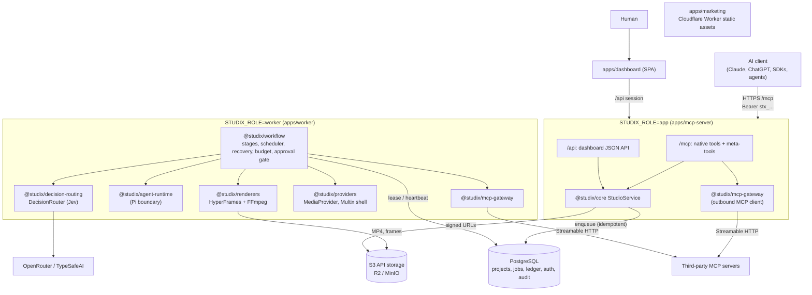
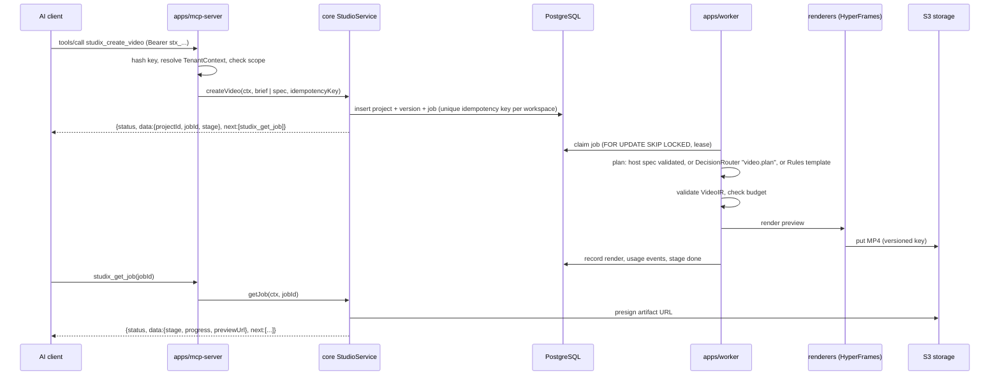
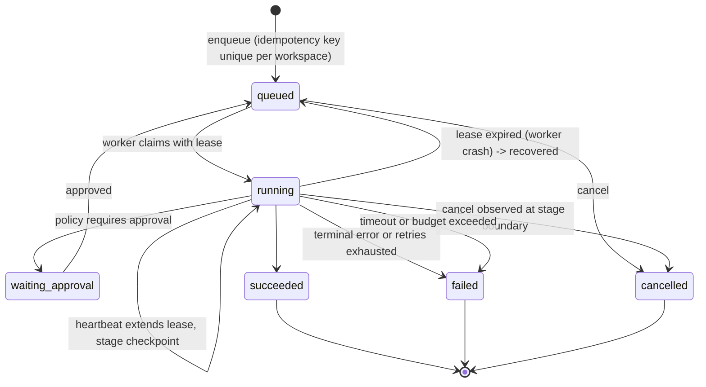

# Architecture

Studix is a modular monolith: one repository, one domain service layer, two
runtime roles (`app`, `worker`) built from one container image, plus an
independent static marketing site. This file records the boundaries and why
they exist. Package source is the authority for behavior.

Status: **P0 target**. Each package row names its owner path; once that path
exists, read it instead of this table.

## System diagram



The marketing site imports no engine code and shares no runtime with the app.

## Package ownership

The rule behind every boundary: each external dependency has exactly one owning
package, so upstream churn changes one wrapper. Packages are scoped `@studix/*`
and export `./src/index.ts`.

| Path                        | Owns                                                                                                                                                                               | Must not                                                            |
| --------------------------- | ---------------------------------------------------------------------------------------------------------------------------------------------------------------------------------- | ------------------------------------------------------------------- |
| `apps/mcp-server`           | HTTP app: `/mcp` (native + meta tools), `/api` for the dashboard, dashboard static files, `/healthz`, `/readyz`                                                                    | Contain pipeline or policy logic; it calls `core` and `mcp-gateway` |
| `apps/worker`               | Worker process: claims jobs and runs workflow stages                                                                                                                               | Expose public HTTP beyond health                                    |
| `apps/dashboard`            | SPA for projects, jobs, traces, playback, connectors                                                                                                                               | Implement its own pipeline; it uses `/api` over `StudioService`     |
| `apps/marketing`            | Static marketing site on Cloudflare                                                                                                                                                | Import engine packages                                              |
| `apps/mock-mcp`             | Third-party Streamable HTTP MCP fixture for gateway tests                                                                                                                          | Ship to production                                                  |
| `packages/shared`           | `StudixError` + `ErrorCode`, `loadConfig()` (env only, zod), logger with redaction, `newId()`, `redact()`, `Clock`                                                                 | Depend on other `@studix/*` packages                                |
| `packages/video-ir`         | `VideoIR`, `Scene`, `Shot`, `Timeline`, `AssetRef`, `BrandKit`, `CreativeBrief`, `RenderSpec` schemas, validation, JSON Schema export, `schemaVersion` migrations, golden fixtures | Import any renderer or provider                                     |
| `packages/core`             | Domain entities, `TenantContext`, port interfaces, `ApprovalPolicy`, `StudioService`; also owns assets and review (ADR-0001)                                                       | Import adapters; it defines ports only                              |
| `packages/database`         | Drizzle schema, SQL migrations, tenant-scoped repositories, `createDb()`, `withTestDatabase()`                                                                                     | Export an unscoped query API                                        |
| `packages/storage`          | `StorageAdapter` over the S3 API, signed URLs                                                                                                                                      | Store binaries in Postgres                                          |
| `packages/workflow`         | Postgres job queue, typed stages, scheduler, crash recovery, budget checks, approval gate                                                                                          | Call a model or provider SDK directly                               |
| `packages/agent-runtime`    | `AgentRuntime` boundary for Pi, plus a fake                                                                                                                                        | Run outside the worker role                                         |
| `packages/decision-routing` | `DecisionRouter`, `DecisionProviderAdapter`, OpenRouter, TypeSafeAI, Rules and Fake adapters, shared contract suite                                                                | Leak provider payloads to callers                                   |
| `packages/providers`        | `MediaProvider` contract, Multix shell, fake provider                                                                                                                              | Claim modalities that are not wired end to end                      |
| `packages/renderers`        | `RendererAdapter`: HyperFrames first, FFmpeg finishing                                                                                                                             | Be imported by `core` or `video-ir`                                 |
| `packages/skills`           | Versioned workflow templates and recipes (brand-intro first)                                                                                                                       | Hold tenant data                                                    |
| `packages/mcp-gateway`      | Server registry, tool catalog, policy, URL policy, MCP client adapter, execution, invocation trace                                                                                 | Forward the inbound client credential downstream                    |
| `packages/auth`             | Workspace API keys (hash, verify, revoke, scope), dashboard sessions to membership to workspace                                                                                    | Store plaintext keys                                                |
| `packages/billing`          | Usage ledger (COGS and price recorded separately), dedupe keys                                                                                                                     | Hardcode a credit conversion                                        |
| `packages/observability`    | Trace/span model with org/workspace/project/job/stage/provider/model attributes, redacted                                                                                          | Record secrets or raw prompts by default                            |

Search is deferred to P1 (ADR-0001). Infrastructure files (Dockerfile, compose,
Cloudflare and TOSE config) are listed in [DEPLOYMENT.md](DEPLOYMENT.md).

## Request flow: `studix_create_video`



Why this shape:

- The create call returns quickly; no HTTP request waits on a render.
- A host that already wrote a creative spec submits it and the internal planner
  is skipped, so the creative model is never paid for twice.
- The worker is the only role that touches Chromium, FFmpeg, models or media
  providers. The app role stays small and I/O bound.

## Durable job lifecycle

The queue is a Postgres `jobs` table ([ADR-0005](decisions/0005-durable-jobs-on-postgres.md)).
State names below are conceptual; the enum lives with the job schema in
`packages/core` and `packages/database`.



Invariants:

- A stage checkpoint is written before its side effect is considered done, so a
  recovered job resumes at the last completed stage instead of restarting.
- Usage events carry dedupe keys, so a retried stage never double-bills.
- Per-workspace concurrency is enforced at claim time.
- Approval state lives in Postgres, so it survives worker restarts. Publish and
  high-cost steps fail closed without a recorded approval.
- Mutating downstream MCP calls are not auto-retried when the outcome is unknown.

## MCP-in-MCP gateway placement

Studix is an MCP server to AI clients and an MCP client to workspace-registered
third-party servers ([ADR-0004](decisions/0004-mcp-in-mcp-gateway-trust-boundary.md)).

```text
AI client --(inbound credential: stx_ key)--> /mcp
                                               |-- native tools -> StudioService
                                               '-- studix_tool_search / inspect / execute
                                                       |
                                              @studix/mcp-gateway
                               registry + catalog + policy + url-policy (workspace-scoped)
                                                       |
                              (outbound credential: secretRef, resolved per call)
                                                       |
                                     third-party Streamable HTTP MCP servers
```

- One northbound endpoint. Downstream tools never appear in `tools/list`; they
  are reached through three meta-tools.
- The gateway is a library used by both roles: the app role serves meta-tool
  calls, the worker role lets a workflow stage call a bound capability.
- Every execute re-authorizes against the current grant, not the search result.

## Trust boundaries

| Boundary                      | Crossing                 | Control                                                                                                                                                               |
| ----------------------------- | ------------------------ | --------------------------------------------------------------------------------------------------------------------------------------------------------------------- |
| Internet -> app               | AI client, browser       | TLS, host allow-list from `STUDIX_*_URL`, API key or session, per-workspace rate limits                                                                               |
| App -> tenant data            | Every repository call    | `TenantContext` required; no unscoped query API                                                                                                                       |
| App/worker -> third-party MCP | Outbound connector call  | URL policy (SSRF, DNS rebinding, redirects), secretRef, caps, re-authorization                                                                                        |
| Worker -> model providers     | Decision and media calls | Server-held credentials, redaction, budget, timeouts                                                                                                                  |
| Worker -> provider credential | Decrypt at execution     | Sealed vault bound to workspace and ref, per-connection owner check, in-memory runtime auth ([ADR-0011](decisions/0011-provider-connections-and-model-resolution.md)) |
| Worker -> agent runtime       | Pi session               | Process/pod isolation, not a path guard; no shell, no secrets in prompt                                                                                               |
| Storage -> client             | Artifact download        | Short-lived signed URLs, tenant-prefixed keys                                                                                                                         |

Details and threat list: [SECURITY.md](SECURITY.md).

## Configuration

All configuration comes from the environment through `loadConfig()` in
`packages/shared`. Hostnames are never literals in code: `STUDIX_PUBLIC_URL`,
`STUDIX_APP_URL`, `STUDIX_MARKETING_URL`. `STUDIX_ROLE` selects `app` or
`worker`. The annotated template is `.env.example` at the repo root.
